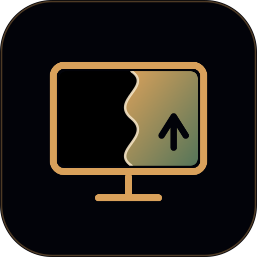
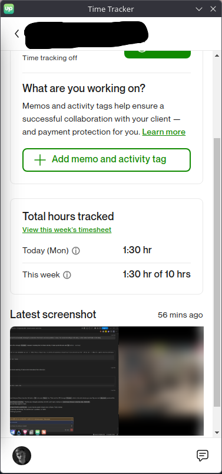
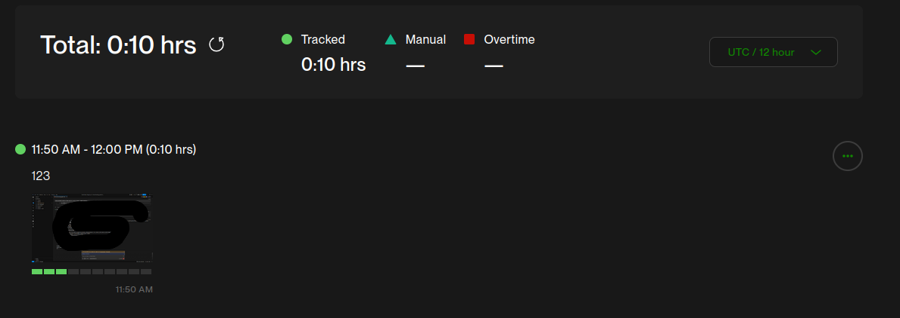

<p align="center">
  
</p>

<h1 align="center">Upwork meets Wayland</h1>

<p align="center">
  <b>Real screenshots for the Upwork tracker on Linux Wayland.</b><br>
  X11 already worked. Now all of Linux does.<br>
  <sub>Project name for search: <code>upwork-wayland-fix</code> · KDE · GNOME · Sway · Hyprland · COSMIC</sub>
</p>

# Upwork Wayland Fix: real screenshots for the Upwork time tracker on Linux

**Fixes the Upwork desktop app on Wayland:** black screenshots in the Work Diary,
*"Please switch to Xorg"*, *"Screenshots are not supported on Wayland"*, and the
app window going black / crash-looping. One workaround for **KDE Plasma, GNOME,
Sway, Hyprland, COSMIC and other Wayland compositors**, built from the best
community fixes plus new reverse-engineering of the Upwork app.

**Why it matters:** on a real X11 session the Upwork tracker already works. Wayland
was the missing piece. This closes the circle, so the whole Linux desktop can use
Upwork's time tracker with real screenshots.

Works with the official Upwork desktop app 5.8.x (Electron 18). Nothing of
Upwork is redistributed: the installer patches your own local copy (backups are
kept, one command restores everything).

```
Upwork snap:  gdk_pixbuf_get_from_window(XWayland root)  →  all-black frame
                    │  (every Wayland compositor, no exceptions)
                    ▼
libuwsnap.so (preloaded): detects the black result
                    │  real capture via your compositor's tool
                    ▼
uwsnap.py → Spectacle / gnome-screenshot / grim / xdg-desktop-portal
                    │  rescaled to the X11 layout, active screen cropped
                    ▼
Upwork encodes and uploads REAL pixels
```

> **Purpose.** This exists only so the official tracker can capture the **real
> screenshots of your real screen** on Wayland. It does not create, edit or fake
> any screenshot or activity data. See [Disclaimer](#purpose-and-disclaimer).

## Proof it works

Real KDE Plasma 6 Wayland session (`XDG_SESSION_TYPE=wayland`), Upwork 5.8.0-35,
all-screens mode. Left: the tracker's "Latest screenshot" shows both monitors
(right screen blurred for privacy). Right: the same snap in the web Work Diary.

<p>


</p>

## Status

| Compositor | Capture backend | Status |
|---|---|---|
| KDE Plasma 6 | Spectacle | ✅ **tested end-to-end** by the author (active screen + all screens) |
| GNOME | gnome-screenshot / portal | 🟡 **this tool's GNOME backend is untested: testers wanted.** The only project verified on this exact Upwork version on GNOME is [badereddine-mechergui's](https://github.com/badereddine-mechergui/upwork-wayland-screenshot-fix) (Ubuntu 26.04), use it if you need GNOME today |
| Arch Linux (any DE) | per-DE backend | ⚠️ implemented, untested here: testers wanted (AUR `upwork-wayland` by tiesselune is the established alternative) |
| sway / Hyprland / river / labwc / Wayfire | grim | ⚠️ implemented, untested: testers wanted |
| COSMIC | xdg-desktop-portal Screenshot | ⚠️ implemented, untested: testers wanted |
| any, via portal | xdg-desktop-portal Screenshot | ⚠️ fallback; may ask consent once |
| real X11 session | unnecessary, Upwork works natively | n/a |

**Help wanted:** run `~/.local/bin/uwsnap.py --test` and open a
[compositor report](../../issues/new?template=compositor-report.yml) with the
output. Every report turns a ⚠️ into a ✅ and I adapt the backends from your logs.

## Install

You need the Upwork desktop app installed first (default location `/opt/Upwork`;
set `UPWORK_DIR=/path/to/Upwork` if yours differs), a C compiler, Python 3 with
Pillow, and a capture tool for your desktop. The installer asks for `sudo` only
for the system-level steps (preload entry and the two Upwork file patches).

```bash
git clone https://github.com/KruTimCh/upwork-wayland-fix
cd upwork-wayland-fix/files
./install.sh
```

Then **fully close and restart Upwork** (use the new launcher/desktop entry).
The first snap of each 10-minute block takes about 2 s longer.

### Dependencies per platform

| Platform | Install the prerequisites |
|---|---|
| **Ubuntu / Debian / KDE neon** | `sudo apt install build-essential python3-pil` + `spectacle` (KDE) / `gnome-screenshot` (GNOME) / `grim` (sway, Hyprland…) |
| **Fedora** | `sudo dnf install gcc libX11-devel libXext-devel python3-pillow` + `spectacle` / `gnome-screenshot` / `grim` |
| **Arch / Manjaro** | `sudo pacman -S base-devel libx11 libxext python-pillow` + `spectacle` / `gnome-screenshot` / `grim` |
| **openSUSE** | `sudo zypper install gcc libX11-devel libXext-devel python3-Pillow` + capture tool |
| **COSMIC / other** | no extra tool needed: uses `xdg-desktop-portal` (may ask for consent once) |

Pick the capture tool for **your** desktop: Spectacle on KDE, `gnome-screenshot`
on GNOME, `grim` on wlroots compositors. The installer detects your desktop and
warns if the tool is missing.

### Install it with your AI assistant

Paste this into Claude, ChatGPT or any coding assistant that can run commands on
your machine:

```text
Install https://github.com/KruTimCh/upwork-wayland-fix on my Linux machine so the
Upwork desktop app takes real screenshots on Wayland. Read its README first.
Detect my distro and desktop (echo $XDG_CURRENT_DESKTOP, cat /etc/os-release),
install the prerequisites for my platform from the README, run files/install.sh
(it needs sudo for the preload and the two Upwork patches), then run
~/.local/bin/uwsnap.py --test and tell me if the verdict is REAL. Do not push or
change anything else. If my desktop is not marked tested, tell me to open a
compositor report with the --test output.
```

### Capture modes

- **Active screen** (default after every Upwork restart): the focused monitor
  fills the whole snap, readable on any monitor size.
- **All screens**: switch it in Upwork's tracker window. Works since the
  `app.asar` patch (see below). Upwork resets the choice to *active screen*
  whenever it restarts.
- Force active-screen-only regardless of Upwork's setting: `touch ~/.config/uwsnap-active-only`.

### Custom capture command

```bash
export UPWORK_SCREENSHOT_COMMAND="flameshot full -p"   # output path appended
```

### After an Upwork update

Updates replace the patched files. Re-run `./install.sh` (it is idempotent).
If it reports the patch target was not found, the app changed: open an issue
with your Upwork version.

## Uninstall

```bash
./files/uninstall.sh
```

Restores the original `uta_native.node` and `app.asar` from backup and removes
every installed file.

## Why it breaks, in short

1. The app captures with `gdk_pixbuf_get_from_window(root)`, the **XWayland root
   window**, which no Wayland compositor draws into: an all-black frame.
2. In all-screens mode Upwork then **replaces** the native snap with an Electron
   `desktopCapturer` image that is also black but passes its `!isEmpty()` check.
3. Separately, the app's renderers crash-loop on some stacks (V8 CHECK in
   `UnwindAndFindHandler`), fixed with `--js-flags=--noexpose-wasm`.

Known gap: keyboard/mouse **activity counts** are not yet fed to Upwork on Wayland
(planned, see [prior art](docs/prior-art.md)).

Full write-ups: [reverse-engineering notes](docs/reverse-engineering.md),
[debugging chronicle](docs/debugging-chronicle.md) (every dead end),
[technical brief for Upwork's engineers](docs/upwork-technical-brief.md).

## Other community fixes (and when to use them)

This project combines and extends them. If one of these fits your setup better,
use it, and please credit them:

| Project | Best for | Technique |
|---|---|---|
| [badereddine-mechergui/upwork-wayland-screenshot-fix](https://github.com/badereddine-mechergui/upwork-wayland-screenshot-fix) (MIT) | **GNOME Wayland** (verified on Upwork 5.8.0.35, Ubuntu 26.04) | patches `app.asar` to take a portal screenshot and adds an evdev keyboard/mouse activity counter |
| [kellpossible/upwork-wayland](https://github.com/kellpossible/upwork-wayland) (MIT) | **KDE Plasma 6** (Rust) | `LD_PRELOAD` shim + xdg-desktop-portal screenshot + idle via `ext_idle_notify_v1` |
| [muhammad-rafey/upwork-wayland-workaround](https://github.com/muhammad-rafey/upwork-wayland-workaround) (MIT) | GNOME (as claimed by its README) | D-Bus bridge implementing `org.gnome.Shell.Screenshot` with `grim`; see [prior art notes](docs/prior-art.md) |
| [MarSoft/upwork-wayland](https://github.com/MarSoft/upwork-wayland) | **Sway / wlroots** | bridges Upwork's GNOME screenshot D-Bus interface to `grim` |
| [tiesselune/upwork-wayland](https://github.com/tiesselune/upwork-wayland) (AUR `upwork-wayland`) | **Arch** (AUR) | shim library replacing Upwork's GDK capture calls, external capture command |
| **this project** | **KDE** (tested) + all-in-one for the rest | black-frame detection at the exact GDK call, per-compositor backends, active-screen selection, crash fix, all-screens fix |

More community projects (code reviewed, see [docs/prior-art.md](docs/prior-art.md)):
[drsh4dow/upwork-wlroots-bridge](https://github.com/drsh4dow/upwork-wlroots-bridge)
(Rust, wlroots screenshot + idle D-Bus servers),
[badereddine-mechergui/upwork-wayland-screenshot-fix](https://github.com/badereddine-mechergui/upwork-wayland-screenshot-fix)
(GNOME Wayland),
[niiithish/upwork-wayland-hyprland](https://github.com/niiithish/upwork-wayland-hyprland)
(Hyprland / Omarchy).

Support for more compositors is planned: reports from real systems drive it.

## Troubleshooting

| Symptom | Check | Fix |
|---|---|---|
| Black thumbnail, `refill done` in `/tmp/uwsnap.log` | `uwsnap.py --test` | backend capture failing: install the capture tool for your desktop |
| Black app window | `grep -c 'Terminating renderer'` in the app's stderr log | verify the launcher flags (`--noexpose-wasm`) |
| "please switch to Xorg" placeholder | launcher used? | launch via `~/.local/bin/upwork`, not the stock binary |
| All-screens snap black, native `.png` replaced by a stitched `.jpg` | app log `screenSnap.filename` | re-run `sudo files/patch-asar.sh` |
| Snap shows the wrong monitor | active output detection | per-desktop support: report your compositor |
| "View work diary" opens a `kioexec` window (KDE) | `journalctl \| grep kioexec` | your browser's `.desktop` `Exec=` line lacks `%U`: add it |
| App never snaps | `ps eww $(pgrep -x upwork \| head -1) \| grep -o XDG_SESSION_TYPE=x11` | session spoof missing: use the launcher |

## FAQ

**Does this fake my activity or screenshots?** No. It only gives Upwork's own
capture call real pixels of your real screen. Never use it to misrepresent your
work.

**Will Upwork ban me?** I can't promise anything about Upwork's policies. The fix
changes nothing about what is captured or reported. I reported the root cause
and a suggested official fix to Upwork support. Use it at your own risk and read
the disclaimer.

**Do I need it on X11?** No, Upwork works natively on a real X11 session.

## Purpose and disclaimer

This workaround exists for **one reason**: so that the official Upwork
time-tracker can take the **real screenshots of your real screen** on Wayland,
where it otherwise captures black frames or refuses to run. It does not
generate, edit or fake any content, and it must never be used to misrepresent
your work or activity. Use it honestly and comply with Upwork's terms and your
contract with your client.

This is an unofficial, community project, **not affiliated with or endorsed by
Upwork**. It modifies local copies of files of the Upwork desktop app on your
machine (backups are kept; `uninstall.sh` restores them) and ships no Upwork
code. You use it **at your own risk**. Any modification of this code, by anyone,
is the responsibility of whoever makes it. No warranty (see the GPL-3.0
license): the author is not responsible for data loss, account actions by
Upwork, or any other consequence of using or modifying this software.

## Credits

This project combines and builds on the work of others. Thank you:

- **[MarSoft/upwork-wayland](https://github.com/MarSoft/upwork-wayland)**: the
  original idea of bridging Upwork's GNOME screenshot D-Bus interface to `grim`
  for Sway / wlroots.
- **[muhammad-rafey/upwork-wayland-workaround](https://github.com/muhammad-rafey/upwork-wayland-workaround)**
  (MIT): the GNOME Wayland D-Bus bridge and the `XDG_SESSION_TYPE=x11` launcher
  trick.
- **[tiesselune/upwork-wayland](https://github.com/tiesselune/upwork-wayland)**
  (AUR `upwork-wayland`): replacing Upwork's GDK capture calls with a shim
  library and an external capture command.

Thanks also to the authors of the other projects listed above; if I missed your
work, open an issue and I'll add it.

What this project adds: black-frame detection with refill at the exact GDK call
Upwork uses, multi-compositor capture backends, active-screen selection, the
renderer crash-loop fix, and the fix for Upwork's `desktopCapturer` replacement
that blacks out all-screens snaps.

## License

GPL-3.0-or-later. See [LICENSE](LICENSE).
